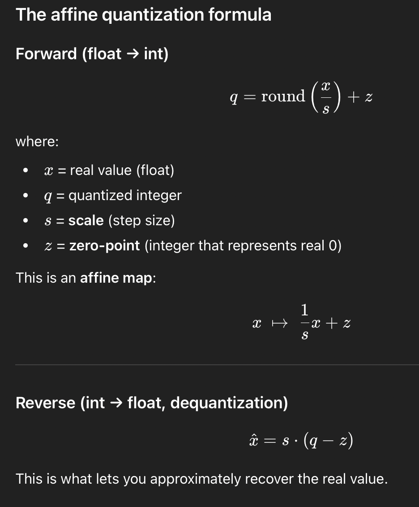
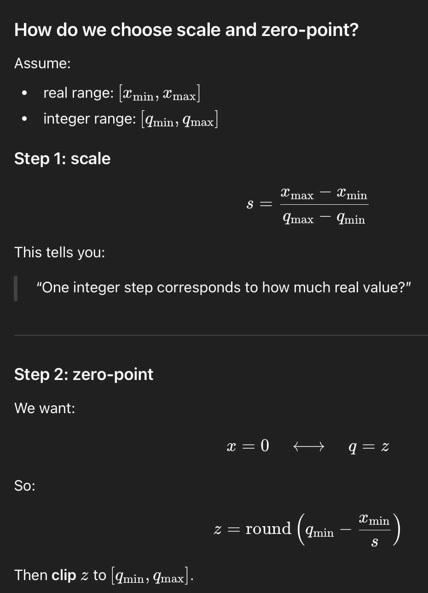

# LLM Inference

https://huggingface.co/blog/Kseniase/inference

In Machine Learning language, the testing stage is applying the trained models on new unseen data. The same process in inference where the trained models are applied on new unseen data by taking the user's prompt and running it through the trained parameters is referred to as inference.

As the number of parameters in the language increase, the inference time also increases since the user prompts go through the trained parameters to predict one token at a time.

## Model Optimizations

- Pruning: removing the less significant model parameters which makes it more efficient without the cost of decreased performance.
- Quantization: Lowering the numerical precison of the model parameters reduces computational overhead.
- Knowledge Distillation: Training a smaller model (a "student") to mimic the behavior of a larger, more complex model (a "teacher") enables compact models suitable for inference.

## Efficient Attention Mechanisms

- Sparse Attention: Focusing attention on a subset of the input tokens instead of the entire sequence.
- Linearized Attention: Approximating the attention mechanism with linear complexity.
- Flash Attention: Optimizing attention computation for faster execution on GPUs.

# Quantization

https://huggingface.co/docs/optimum/en/concept_guides/quantization
https://leimao.github.io/article/Neural-Networks-Quantization/
https://newsletter.maartengrootendorst.com/p/a-visual-guide-to-quantization

Quantization is a technique to reduce the computational and memory costs of running inference by representing the weights and activations with low-precision data types like 8-bit integer (int8) instead of the usual 32-bit floating point (float32).

Reducing the number of bits means the resulting model requires less memory storage, consumes less energy (in theory), and operations like matrix multiplication can be performed much faster with integer arithmetic.

The two most common quantization cases are float32 -> float16 and float32 -> int8.

Quantization to float16

Performing quantization to go from float32 to float16 is quite straightforward since both data types follow the same representation scheme. The questions to ask yourself when quantizing an operation to float16 are:

Does my operation have a float16 implementation?
Does my hardware support float16? For instance, Intel CPUs have been supporting float16 as a storage type, but computation is done after converting to float32. Full support will come in Cooper Lake and Sapphire Rapids.
Is my operation sensitive to lower precision? For instance the value of epsilon in LayerNorm is usually very small (~ 1e-12), but the smallest representable value in float16 is ~ 6e-5, this can cause NaN issues. The same applies for big values.

Quantization error - the difference in the original representation vs the dequantized representation. Since quantization maps few lesser occuring floating point values to the same integer, decoupling makes it such that it is no longer distinguishable. the difference between the original and the new value is the dequantization error

Post Training Quantization (PTQ)

Post Training Quantization (PTQ) is a technique to reduce the required computational resources for inference while still preserving the accuracy of your model by mapping the traditional FP32 activation space to a reduced INT8 space. TensorRT uses a calibration step which executes your model with sample data from the target domain and track the activations in FP32 to calibrate a mapping to INT8 that minimizes the information loss between FP32 inference and INT8 inference.

https://medium.com/better-ml/quantization-aware-training-qat-vs-post-training-quantization-ptq-cd3244f43d9a

The architectural vs training data effects on generalization and memorization
